# Current architecture

How develop and production run today. Both environments have the same shape; only hostnames, the database, and the Terraform root differ.

| Env        | Client                          | Admin                                 | API                                 | Database          |
| ---------- | ------------------------------- | ------------------------------------- | ----------------------------------- | ----------------- |
| develop    | `dev.respark.kevinmccartney.is` | `dev.admin.respark.kevinmccartney.is` | `dev.api.respark.kevinmccartney.is` | `respark_develop` |
| production | `respark.kevinmccartney.is`     | `admin.respark.kevinmccartney.is`     | `api.respark.kevinmccartney.is`     | `respark`         |

Terraform roots: [`infra/envs/develop`](../infra/envs/develop/) and [`infra/envs/production`](../infra/envs/production/). The API service is [`infra/modules/api_service`](../infra/modules/api_service/); web is [`infra/modules/ui`](../infra/modules/ui/); the database is [`infra/modules/db`](../infra/modules/db/).

## Web

Client and admin are Vite builds synced to a private S3 bucket per app and env, served by CloudFront (ACM certificate, origin access control). `VITE_API_URL` and `VITE_CLERK_PUBLISHABLE_KEY` are baked in at build time.

## API

One ECS Fargate service per env (ARM64, one task, default VPC public subnets with a public IP, so no NAT gateway or load balancer). Each task runs three containers:

- **api**: the image from [`apps/api/Dockerfile`](../apps/api/Dockerfile), listening on `localhost:3000`. Runs migrations on start (`RUN_MIGRATIONS=true`).
- **caddy**: the official Caddy image as a reverse proxy. It terminates TLS with a Let's Encrypt certificate and redirects HTTP to HTTPS. Its data directory is on EFS, so certificates survive restarts and deploys (Let's Encrypt limits reissuing the same certificate).
- **dns-updater**: starts after `api` is healthy, looks up the task's public IP, upserts the API's Route53 A record (TTL 60), and exits.

The task security group opens 80 and 443 to the internet; nothing else is public.

**Trade-offs of TLS-in-the-task:**

- Every deploy or restart gives the task a new public IP. Clients may hit the old IP for up to about a minute (the record TTL) after a deploy.
- One task per env; there is no load balancer to spread traffic across more.
- The first start on a fresh EFS volume issues the certificate after DNS points at the task, so HTTPS takes a minute or two to come up.

## Data

One RDS Postgres instance (`respark-db`), managed by the production Terraform root, holds a database per env:

- `respark`: production, owned by the master user.
- `respark_develop`: develop, owned by the `respark_develop` login. Develop's Terraform generates its password and writes the connection string to SSM; [`scripts/db-create-env.sh`](../scripts/db-create-env.sh) creates the role and database (idempotent).

RDS is not publicly reachable; its security group allows 5432 only from each env's API task security group. Connections use TLS, verified against the RDS CA bundled in the API image. Backups are RDS automated backups (7 days) for the whole instance, plus a final snapshot if the instance is ever deleted.

## Secrets

SSM Parameter Store under `/respark/<env>/api/`, injected into the api container by ECS at task start:

| Parameter                      | Source                                     |
| ------------------------------ | ------------------------------------------ |
| `database-url`                 | Terraform                                  |
| `clerk-secret-key`             | `task api:secrets:push` (from `.env.$ENV`) |
| `clerk-webhook-signing-secret` | `task api:secrets:push`                    |

The task role grants Bedrock invoke for deck chat; `BEDROCK_MODEL_ID` is a plain environment variable in the task definition.

## Deploys

| Task                       | What it does                                                                                       |
| -------------------------- | -------------------------------------------------------------------------------------------------- |
| `task infra:apply ENV=…`   | Terraform for the env                                                                              |
| `task api:deploy ENV=…`    | Build the arm64 image, push `:<tag>` and `:latest` to ECR, force a new ECS deployment, wait stable |
| `task client:deploy ENV=…` | Build client, sync to S3, invalidate CloudFront                                                    |
| `task admin:deploy ENV=…`  | Build admin, sync to S3, invalidate CloudFront                                                     |
| `task deploy ENV=…`        | All of the above                                                                                   |

CI runs the same tasks; see [`ci-cd.md`](ci-cd.md).

## Database access

`task db:tunnel ENV=…` opens an SSM port-forward from `localhost:15432` to RDS through the running API task (ECS Exec). `task db:url ENV=…` prints that env's connection string; the purge tasks use the tunnel. Requires the AWS CLI Session Manager plugin.

## Logs

Each container logs to the CloudWatch log group `/respark/<env>/api` (stream prefix per container).

## Costs at a glance (us-east-1, approximate monthly)

| Item                                   | Per env | Shared |
| -------------------------------------- | ------- | ------ |
| Fargate 0.5 vCPU / 1 GB ARM, always on | ~$14    |        |
| Public IPv4 on the task                | ~$3.60  |        |
| EFS (a few KB of certificates)         | <$0.10  |        |
| CloudFront + S3 for client and admin   | ~$1     |        |
| RDS db.t4g.micro + 20 GB gp3           |         | ~$14   |
| Route53 hosted zone                    |         | $0.50  |

## Local

Local development runs on Docker Compose (`task docker:up`) or `task api:dev` against the Compose Postgres, with env from the repo-root `.env.local`. Each environment uses its own Clerk instance; keys live in the root `.env.develop` / `.env.production`.
